# Deep Learning: Practical Projects (Assignment 5)

AI Engineering Program, Module 4: Deep Learning, Part 3 (Train Better and Ship).

This repository contains two completed projects:

| # | Project | Client | What it shows |
|---|---|---|---|
| 1 | [Little data, big model](#project-1--little-data-big-model) | Courier company | Underfitting, overfitting and the fix, proven with learning curves |
| 5 | [Live training dashboard](#project-5--live-training-dashboard) | City Hospital | A Streamlit page that trains a model live, diagnoses the curves and reports cancers found |

Both projects use PyTorch, run on a normal laptop CPU in under a minute, and use a fixed seed, so you get the same numbers every time.

---

## Repository structure

```
.
├── README.md
├── requirements.txt
├── project1-little-data-big-model/
│   ├── Project1_Little_Data_Big_Model.ipynb   # the full project, with outputs
│   ├── curves.png                             # main deliverable: 3 learning-curve plots
│   ├── p1_results.csv                         # results table
│   └── *.png                                  # extra graphs (accuracy, gap, weights, confusion, mistakes, data)
└── project5-live-training-dashboard/
    ├── trainer.py                             # training engine (no Streamlit inside)
    ├── app.py                                 # Streamlit dashboard
    ├── Project5_Live_Training_Dashboard.ipynb # experiments, graphs, final test, report
    ├── experiments.csv                        # experiments table downloaded from the dashboard
    ├── experiments_notebook.csv               # same 5 experiments, run from the notebook
    ├── REPORT.md                              # report for the hospital
    ├── screenshots/                           # dashboard screenshots
    └── p5_*.png                               # notebook graphs
```

## Setup

Requires Python 3.10 or newer.

```bash
git clone <this-repo-url>
cd <repo-folder>
pip install -r requirements.txt
```

**Project 1:** open `project1-little-data-big-model/Project1_Little_Data_Big_Model.ipynb` in Jupyter (or Google Colab) and run all cells.

**Project 5, notebook:** open `project5-live-training-dashboard/Project5_Live_Training_Dashboard.ipynb` and run all cells. The Cloudflare tunnel cell only does something on Google Colab; on a laptop it prints a message and skips itself.

**Project 5, dashboard:**

```bash
cd project5-live-training-dashboard
streamlit run app.py
```

Then open <http://localhost:8501>.

Tested with: Python 3.13, torch 2.15.0, scikit-learn 1.7.2, pandas 2.3.3, numpy 2.3.5, matplotlib 3.10.6, streamlit 1.51.0 (Windows 11, CPU only).

---

## Project 1 · Little data, big model

> "We have only 200 labelled pincode digits. Train a reader, and prove with curves that it is learning, not memorising."

### Objectives
- Train a digit reader on only **200** labelled images.
- Record training **and** validation loss after every epoch, and plot them.
- Compare a small model, a big model, and a big model with regularisation, then decide which one ships.

### Implementation
1. **Data:** scikit-learn `load_digits` (1,797 images, 8×8 pixels). Pixels divided by 16 to get 0–1.
2. **Split (fixed seed, stratified):** 200 train, then the rest in half: 798 validation, 799 test.
3. **One training loop** for all models: one full-batch update per epoch, then `model.eval()` + `torch.no_grad()` to measure both losses under the same conditions (dropout off).
4. **Three models, 300 epochs each:**

| Model | Layers | Optimiser |
|---|---|---|
| Small | `Linear(64, 10)` | SGD, lr 0.01 |
| Big | 64 → 256 → 256 → 10, ReLU | Adam, lr 0.001 |
| Big + dropout + decay | same, `Dropout(0.3)` after each hidden layer | AdamW, lr 0.001, weight decay 0.05 |

5. **Early stopping** for the third model: save `best_<name>.pt` whenever validation loss improves, stop after 30 epochs without improvement, then reload the best checkpoint.
6. The **test set is used once**, only for the final table.

### Results

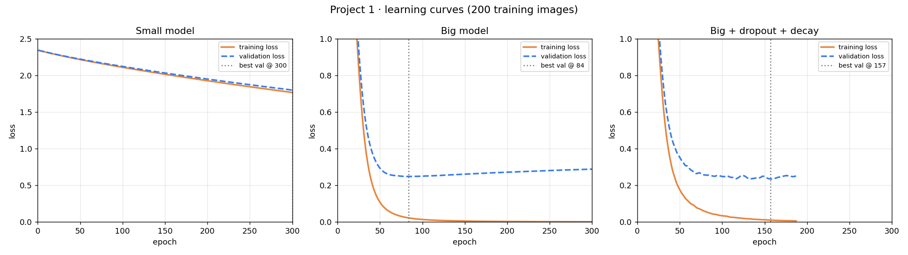

| Model | Epochs run | Final training loss | Best validation loss | Test accuracy |
|---|---|---|---|---|
| Small | 300 | 1.767 | 1.800 at epoch 300 | 0.751 |
| Big | 300 | 0.001 | 0.248 at epoch 84 | 0.934 |
| Big + dropout + decay | 187 (early stop) | 0.006 | **0.234 at epoch 157** | **0.937** |

- **Small:** both curves stay high and close together → **underfitting**.
- **Big:** training loss falls to about 0 while validation loss turns back up after epoch 84 → **overfitting** (it memorises the 200 images).
- **Big + dropout + decay:** the lowest validation loss; it stopped itself at epoch 187, 113 epochs early.

**My decision:** I would ship the **big model with dropout and weight decay** (the saved checkpoint from epoch 157), because it has the lowest validation loss (0.234) and the highest test accuracy (0.937). The win is very small, only 0.3 points over the plain big model, and both big models almost memorised the 200 training images, so the thing that would help most next is **more labelled digits**, not more tuning.

Extra graphs saved by the notebook:

| Accuracy curves | Validation loss + generalisation gap |
|---|---|
| 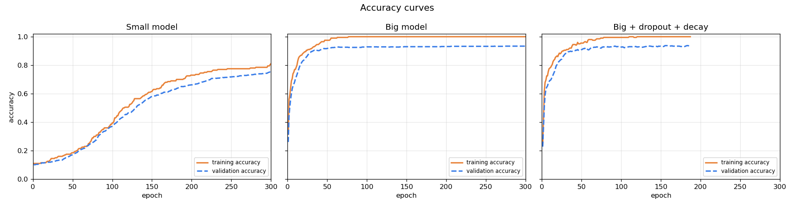 | 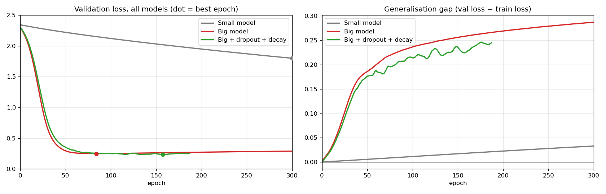 |

| Where the shipped model goes wrong (test set) | Misread digits |
|---|---|
| 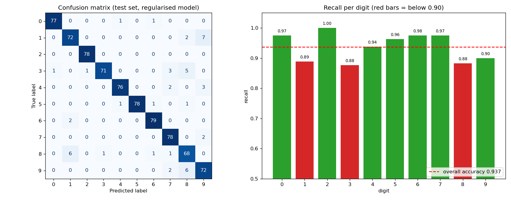 | 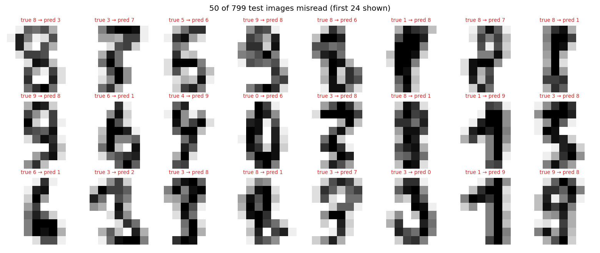 |

Also in the folder: `data_samples.png`, `data_balance.png` (the 200 training images are balanced, 19–21 per digit) and `weights_hist.png`.

### Limitations
1. **Only 200 training images.** Both big models reach almost zero training loss, so they memorise; regularisation helps only a little (0.934 → 0.937).
2. **Some digits are much weaker than others.** Recall is 0.88–0.89 for digits 1, 3 and 8 (for example, 1s read as 9s and 8s read as 1s), even though overall accuracy is 0.937.
3. **Clean 8×8 scans only.** The model has never seen real pincode photos (other resolutions, lighting, rotation or handwriting styles), so accuracy on real envelopes is unknown.

---

## Project 5 · Live training dashboard

> "Our trial screening model reaches a training loss of 0.000, and the doctors do not trust it. Build a page where our data team can watch training and validation loss live, fix the curves, and see how many cancers the model finds."

### Objectives
- Let the data team change the settings, **watch both losses live**, and get an automatic diagnosis.
- Show the numbers doctors care about: **cancers found** and **false alarms**.
- Keep every run in a downloadable table, check single patients, and run the test set **once**.

### Implementation
- **Data (`trainer.load_data`):** scikit-learn breast cancer data, 569 patients, 30 measurements. Labels flipped so **malignant = 1**. Stratified 60 / 20 / 20 split (341 / 114 / 114). `StandardScaler` is fitted on the **training rows only**, with an option to switch scaling off.
- **Model:** 30 → hidden → hidden → 2 with ReLU and dropout, trained with AdamW, full batch (one update per epoch).
- **Engine (`trainer.train`):** after every epoch it records both losses and accuracies and calls an `on_epoch(epoch, hist)` callback. It keeps the best weights in memory and, with early stopping, returns the **best checkpoint**. `trainer.py` knows nothing about Streamlit, so the same engine runs in the notebook and on the page.
- **Diagnosis (`trainer.diagnose`):** training loss above 0.3 → *underfitting*; final validation loss more than 30% above its best → *overfitting*; otherwise *healthy*. One extra label, *unstable*, is given when training loss jumps back up by more than 0.5 (steps too big, e.g. unscaled data) or the loss becomes NaN/inf.
- **Dashboard (`app.py`):**
  - settings in the sidebar
  - a chart redrawn every 5 epochs inside `st.empty()`, plus a progress bar
  - the diagnosis and four numbers
  - six extra graph tabs: accuracy, generalisation gap, confusion matrix, probability spread, ROC curve, threshold trade-off
  - a decision-threshold slider that needs no retraining
  - an experiments table with CSV download
  - "check a patient"
  - a one-time final test

### Results: experiments, one change at a time (validation set)

These are from the dashboard ([`experiments.csv`](project5-live-training-dashboard/experiments.csv)):

| Run | Change | Diagnosis | Epochs | Best val loss | Cancers found | False alarms |
|---|---|---|---|---|---|---|
| 1 | 256 neurons, no fixes | overfitting | 300 | 0.125 @ 23 | 41 of 43 | 3 |
| 2 | + dropout 0.3, weight decay 0.05 | overfitting | 300 | 0.131 @ 24 | 40 of 43 | 2 |
| 3 | + early stopping (patience 20) | healthy | 44 | 0.131 @ 24 | 40 of 43 | 3 |
| 4 | 16 neurons + all fixes | **healthy** | 177 | 0.129 @ 157 | 40 of 43 | **1** |
| 5 | same as 4, **not scaled** | unstable | 27 | 0.430 @ 7 | 33 of 43 | 2 |
| 6 | same as 4, threshold 0.30 | healthy | 177 | 0.129 @ 157 | 41 of 43 | 4 |

Dropout and weight decay alone did **not** fix the overfitting; early stopping and a smaller model did. Without scaling, the same model is unstable.

**Final test (run once, run 4 settings, threshold 0.5):** accuracy **0.947** · **41 of 42** cancers found · **5** false alarms.

Full recommendation and the three reasons it is not ready for real patients: [**REPORT.md**](project5-live-training-dashboard/REPORT.md).

### Screenshots

| Run 1: 256 neurons, no fixes → overfitting | Run 4: 16 neurons + all fixes → healthy |
|---|---|
| 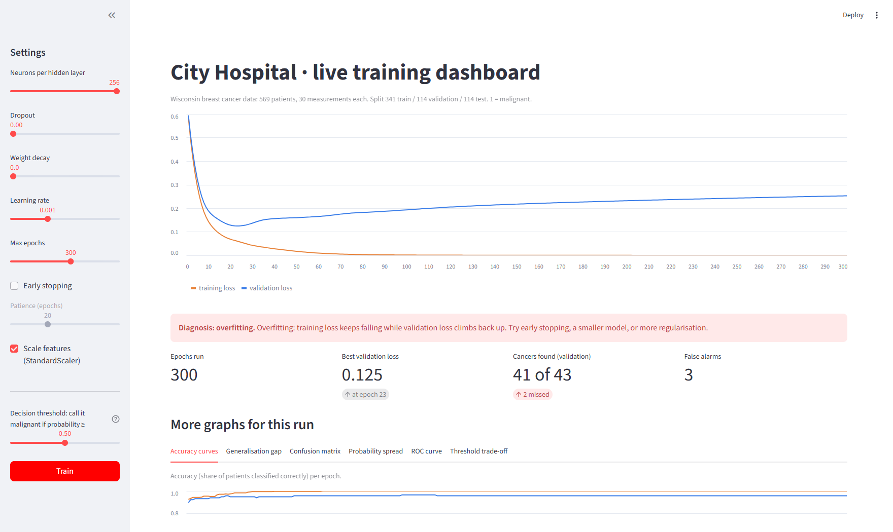 | 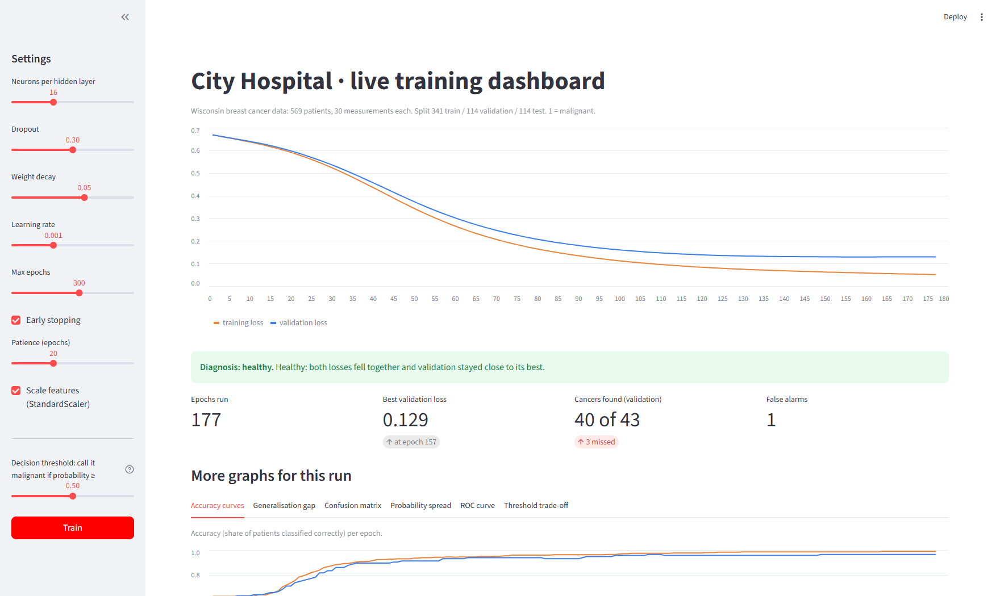 |

| Experiments table (6 runs, CSV download) | Run 5: not scaled → unstable |
|---|---|
| 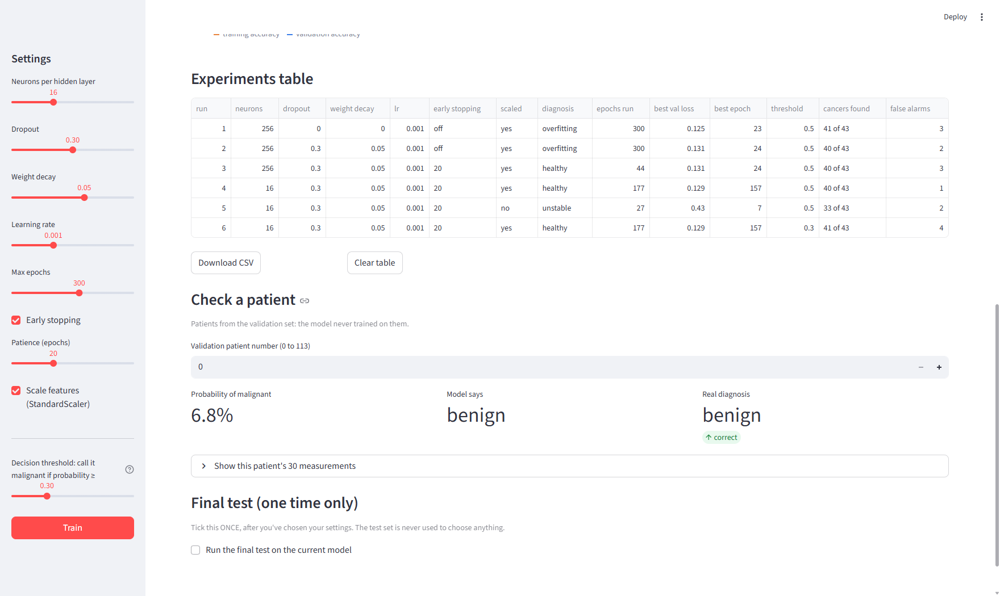 | 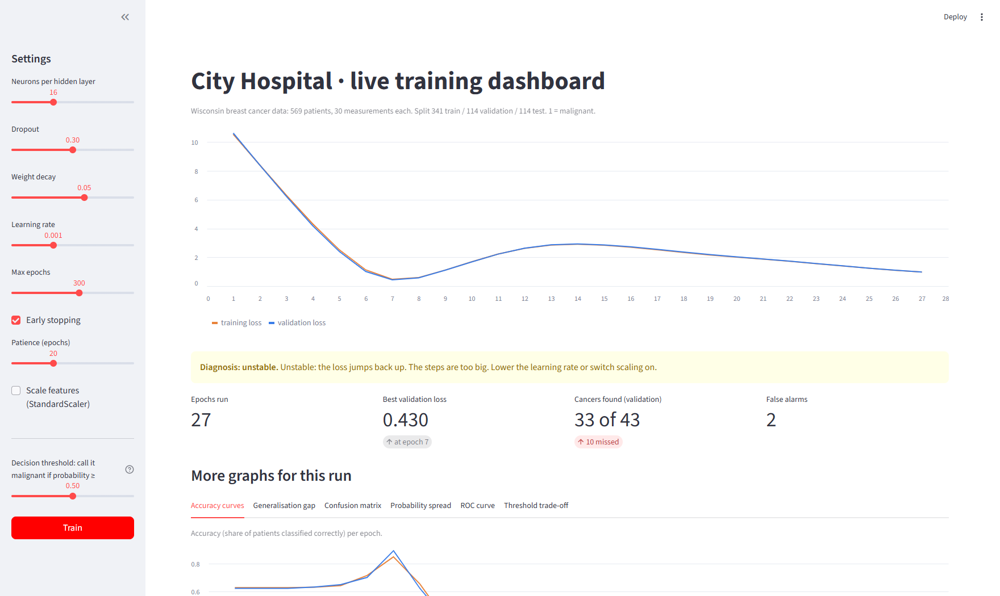 |

| Confusion matrix (threshold 0.30) | Threshold trade-off |
|---|---|
| 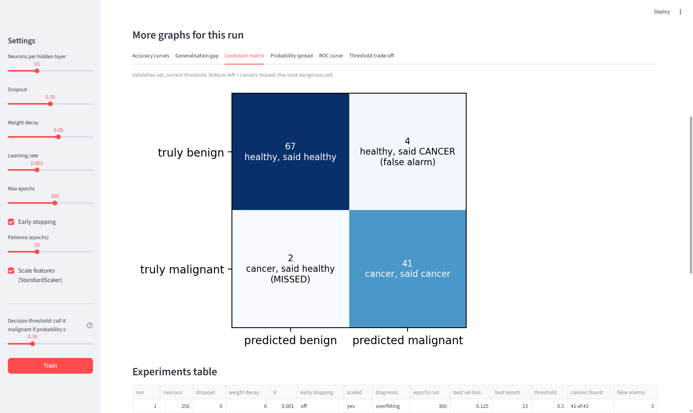 | 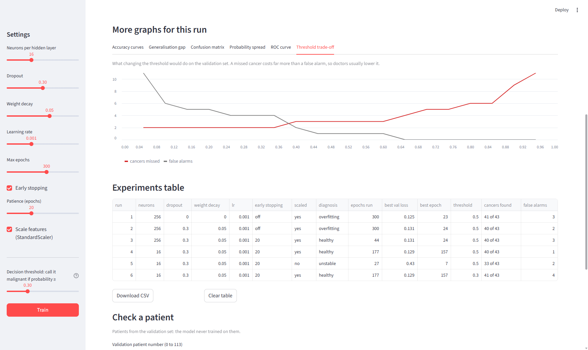 |

| Check a patient |
|---|
| 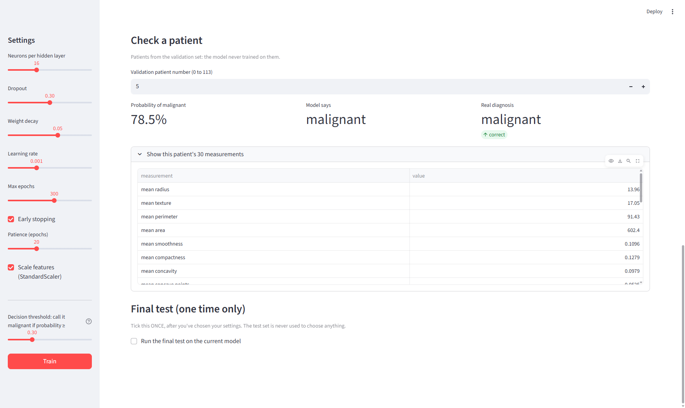 |

All 14 screenshots are in [`project5-live-training-dashboard/screenshots/`](project5-live-training-dashboard/screenshots/). The notebook adds `p5_experiments.png` (all learning curves), `p5_mistakes.png`, `p5_chosen_model.png` and `p5_scaling.png`.

### Limitations
1. **Small, single-source data.** 569 patients from one public dataset; the test set has only 42 cancers, so one patient moves the detection rate by about 2.4 points. The model has not been checked on other hospitals.
2. **It still misses cancers.** 1 of 42 on the test set at threshold 0.5. It can only support a doctor, never replace one.
3. **Fragile to data preparation.** It breaks without scaling, expects exactly these 30 measurements, and has no monitoring, calibration or explanations.
4. **Dashboard limits:** runs are kept only for the browser session (refreshing the page clears the table), training blocks the page while it runs, and it is a single-user tool with no login.
5. **Diagnosis rule is simple.** With early stopping it checks the last epoch, not the restored best checkpoint, so a very large patience can show "overfitting" even though the shipped weights are the best ones.
